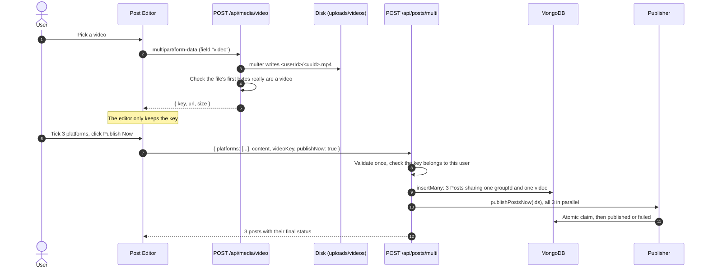

# 🎬 New Features: Video Uploads and Posting to Every Platform at Once

This guide explains, step by step, how two features were added to SocialSync:

1. **Video uploads.** Attach an MP4, MOV or WebM video to a post, not just an image.
2. **Cross-posting.** Write a post once, tick Instagram, Facebook, X and LinkedIn, and send it to all
   of them at the same time: as a draft, scheduled for later, or **published now**.

Every step names the files it touches and shows the code that matters, and says *why* it is built
that way. The full code is already in the repository, so you can follow along file by file, or use
this as a recipe to rebuild the features from scratch.

> [!NOTE]
> Publishing is still **simulated** (see the README). The publisher marks posts as published without
> calling the real platform APIs. Everything in this guide works with that simulation today. The
> [last section](#-going-further-real-platform-publishing) explains what changes for real APIs.

---

## 📋 Contents

- [What the user sees](#-what-the-user-sees)
- [How it fits together](#-how-it-fits-together)
- [Key design decisions](#-key-design-decisions)
- [Files at a glance](#-files-at-a-glance)
- **Part A: Video uploads (backend)**: Steps 1–6
- **Part B: One post to every platform (backend)**: Steps 7–10
- **Part C: Frontend**: Steps 11–14
- **Part D: Test, try and ship**: Steps 15–17
- [Going further: real platform publishing](#-going-further-real-platform-publishing)
- [Troubleshooting](#-troubleshooting)

---

## 👀 What the user sees

On the **Create Post** page:

| Before | After |
|---|---|
| One platform dropdown | A row of **platform chips** (checkboxes) with **Select all** |
| Image upload only | One **"Attach image or video"** picker. Videos upload at once, with a **progress bar** and **Cancel** |
| Save as Draft, Schedule Post | Save as Draft, Schedule Post, **Publish Now** |
| No length check | A **character counter for each platform**, which turns red when the caption is too long (for example over X's 280 characters) |

On the **Schedule** page, each platform's copy appears as its own row, with a 🔗 icon showing it
belongs to a cross-post. Opening one shows the **video player**, the **status on each platform**, and a
**Delete from all N** button.

---

## 🧩 How it fits together



The video is uploaded **once** and stored **once**. Each platform's post refers to the same file
through `video.key`.

---

## 🧠 Key design decisions

| Decision | Why |
|---|---|
| **One `Post` per platform, linked by `groupId`** (instead of one post with a `platforms` array) | The scheduler, analytics, calendar and dashboard already work one post at a time, so they need **no changes**. Each platform can also **fail on its own** (for example "no LinkedIn account"), have its own `platformPostId` and engagement numbers, and be edited on its own. |
| **Videos go to storage, and the post keeps a reference** (instead of base64 like images) | MongoDB documents max out at 16 MB, and base64 adds about 33%. Videos are far bigger, so the file goes to disk and the post stores `{ key, url, mimeType, size }`. |
| **Upload first, then create the post** | The upload can show progress and be cancelled while the user is still writing. Creating the post then sends only a small JSON body, so the 2 MB JSON limit still holds. |
| **The client sends only a `videoKey`**, and the server looks up the URL, type and size | A client can't point a post at an arbitrary URL or claim a false size, and can't use another user's video, because the key starts with the owner's id. |
| **All storage code lives in one file** (`mediaService.js`) | Moving from local disk to S3 or Cloudinary later means rewriting that one file. |
| **"Publish now" uses the scheduler's atomic claim** | A click on Publish Now and a cron tick can never publish the same post twice. |

---

## 🗂️ Files at a glance

| File | | What it does |
|---|:-:|---|
| `backend/src/services/mediaService.js` | 🆕 | Where videos are stored, the content check, key → metadata lookup, cleanup |
| `backend/src/middleware/upload.js` | 🆕 | multer configuration: one file, type allowlist, size limit, friendly errors |
| `backend/src/controllers/mediaController.js` | 🆕 | `POST /api/media/video` and `DELETE /api/media/video/:owner/:file` |
| `backend/src/routes/media.js` | 🆕 | Media routes (auth, then rate limit, then upload) |
| `backend/src/app.js` | ✏️ | Serves `/uploads` and mounts `/api/media` |
| `backend/src/models/Post.js` | ✏️ | Adds `video` and `groupId`, and refuses an image and a video together |
| `backend/src/controllers/postController.js` | ✏️ | Shared validation, `POST /posts/multi`, group delete, video cleanup |
| `backend/src/routes/posts.js` | ✏️ | `/multi` and `/group/:groupId` routes |
| `backend/src/services/publisherService.js` | ✏️ | `claimPost` pulled out, `publishPostsNow` added |
| `backend/src/jobs/scheduler.js` | ✏️ | Hourly sweep of abandoned uploads |
| `backend/src/middleware/rateLimit.js` | ✏️ | `uploadLimiter` (30 per hour per user) |
| `backend/src/services/openaiService.js`, `contentController.js` | ✏️ | `platform: 'all'` for captions that fit every network |
| `backend/src/controllers/analyticsController.js` | ✏️ | `hasVideo` on top posts |
| `backend/tests/media.test.js`, `multiPost.test.js` | 🆕 | 27 new tests (with `publisher.test.js`) |
| `frontend/src/utils/media.js` (+ `.test.js`) | 🆕 | Limits, file checks, `resolveMediaUrl` |
| `frontend/src/services/mediaService.js` | 🆕 | Upload with progress and cancel |
| `frontend/src/components/editor/useMediaAttachment.js` | 🆕 | Hook that owns the attached image or video |
| `frontend/src/components/editor/MediaPicker.jsx` | 🆕 | File input, progress bar, attached-file card |
| `frontend/src/components/common/MediaBadge.jsx` | 🆕 | 🖼️/🎬 placeholder in list views |
| `frontend/src/components/editor/PostEditor.jsx` | ✏️ | Platform chips, length warnings, Publish Now |
| `frontend/src/components/schedule/PostDetailModal.jsx` | ✏️ | Video player, cross-post status, Delete from all |
| `frontend/src/context/PostsContext.jsx`, `services/postsService.js` | ✏️ | `addPosts`, `deleteGroup` |
| `frontend/src/constants/platforms.js` | ✏️ | `maxChars` for each platform |

---

# Part A: Video uploads (backend)

## Step 1: Install multer

Express can't read `multipart/form-data` (file uploads) on its own. [multer](https://github.com/expressjs/multer)
is the standard middleware for it.

```bash
cd backend
npm install multer@^2.4.0
```

> Use **multer 2.x**. The 1.x line has known security issues and is no longer maintained.

Add the new settings to `backend/.env.example` (and your own `.env`):

```dotenv
# Where uploaded videos are stored. Defaults to backend/uploads.
# UPLOAD_DIR=
# Largest video accepted, in megabytes.
MAX_VIDEO_MB=100
```

Add `uploads/` to `backend/.gitignore` so test videos never get committed.

---

## Step 2: Create the storage service

**File:** `backend/src/services/mediaService.js`

Every piece of code that knows *where* videos live goes in this one file.

### 2a. Settings and the key format

```js
// The extension always comes from this table, never from the uploaded file's name.
const VIDEO_TYPES = {
  'video/mp4': '.mp4',
  'video/quicktime': '.mov',
  'video/webm': '.webm',
};

// `<24-hex user id>/<uuid>.<ext>`: anything else is rejected before it can
// reach the filesystem, which rules out path traversal.
const KEY_PATTERN = /^[a-f0-9]{24}\/[0-9a-f-]{36}\.(mp4|mov|webm)$/;

// Read on every call (not at load) so tests can point them elsewhere.
const uploadRoot = () =>
  path.resolve(process.env.UPLOAD_DIR || path.join(__dirname, '../../uploads'));
const maxVideoBytes = () =>
  (Number(process.env.MAX_VIDEO_MB) || DEFAULT_MAX_VIDEO_MB) * 1024 * 1024;

// Relative on purpose: the frontend adds whichever API origin it talks to.
const videoUrl = (key) => `/uploads/videos/${key}`;
```

A **key** such as `6acc…a193/a814…4c78.mp4` names the owner and the file. The key is the only thing the
client ever sends back.

### 2b. Check the file is really a video

The MIME type in an upload is **whatever the client says it is**, so someone could upload an HTML file
labelled `video/mp4`. To catch that, read the first bytes of the file:

```js
// MP4/MOV: bytes 4-7 name the first box, normally `ftyp`.
// WebM: always starts with the EBML magic number 1A 45 DF A3.
const hasVideoSignature = async (filePath, mimeType) => {
  const handle = await fs.open(filePath, 'r');
  try {
    const header = Buffer.alloc(12);
    const { bytesRead } = await handle.read(header, 0, 12, 0);
    if (bytesRead < 8) return false;
    if (mimeType === 'video/webm') return header.subarray(0, 4).equals(EBML_MAGIC);
    const box = header.toString('latin1', 4, 8);
    if (mimeType === 'video/mp4') return MP4_BOXES.includes(box);
    if (mimeType === 'video/quicktime') return MOV_BOXES.includes(box);
    return false;
  } finally {
    await handle.close();
  }
};
```

### 2c. Turn a key into metadata, safely

```js
const resolveVideo = async (userId, key) => {
  if (typeof key !== 'string' || !KEY_PATTERN.test(key)) return null; // malformed / traversal
  if (!key.startsWith(`${userId}/`)) return null;                     // someone else's video
  try {
    const stat = await fs.stat(path.join(videoRoot(), key));             // must exist
    const mimeType = /* look up from the extension */;
    return { key, url: videoUrl(key), mimeType, size: stat.size };
  } catch {
    return null;
  }
};
```

### 2d. Delete a file only when nothing uses it

A cross-post shares **one** file between several posts, so deleting one post must not delete the
video the others still need:

```js
const removeVideoIfUnused = async (key) => {
  if (!key || !KEY_PATTERN.test(key)) return false;
  if (await Post.exists({ 'video.key': key })) return false;
  await fs.rm(path.join(videoRoot(), key), { force: true });
  return true;
};
```

`sweepOrphanVideos()` goes through the upload folders and calls `removeVideoIfUnused` on every file
older than 24 hours. That cleans up videos uploaded in an editor the user then abandoned.

---

## Step 3: Accept the upload with multer

**File:** `backend/src/middleware/upload.js`

```js
const storage = multer.diskStorage({
  // One folder per user, so a stored key always names its owner.
  destination: (req, file, cb) => {
    const dir = userVideoDir(req.user._id);
    fs.mkdir(dir, { recursive: true }, (err) => cb(err, dir));
  },
  // A random name: the original file name is never trusted or reused.
  filename: (req, file, cb) => {
    cb(null, `${crypto.randomUUID()}${VIDEO_TYPES[file.mimetype]}`);
  },
});

const fileFilter = (req, file, cb) => {
  if (VIDEO_TYPES[file.mimetype]) return cb(null, true);
  const error = new Error('Only MP4, MOV and WebM videos are supported');
  error.statusCode = 400;
  cb(error);
};
```

The middleware builds multer **for each request**, so it always reads the current `MAX_VIDEO_MB` (the
tests set it to 1). It also turns multer's error codes into the app's usual JSON responses:

```js
const uploadVideo = (req, res, next) => {
  const limit = maxVideoBytes();
  multer({ storage, fileFilter, limits: { fileSize: limit, files: 1 } }).single('video')(
    req, res, (err) => {
      if (!err) return next();
      if (err instanceof multer.MulterError) {
        const status = err.code === 'LIMIT_FILE_SIZE' ? 413 : 400;
        // ...friendly message for LIMIT_FILE_SIZE / LIMIT_UNEXPECTED_FILE
        return res.status(status).json({ success: false, message });
      }
      next(err);
    }
  );
};
```

> When a file goes over the limit, multer deletes the partly written file itself.

---

## Step 4: Add the upload endpoint

**Files:** `backend/src/controllers/mediaController.js`, `backend/src/routes/media.js`,
`backend/src/middleware/rateLimit.js`

The controller runs after multer has saved the file. It checks the file's first bytes and returns the
key:

```js
const uploadVideo = async (req, res, next) => {
  if (!req.file) return res.status(400).json({ success: false, message: 'No video received...' });

  if (!(await hasVideoSignature(req.file.path, req.file.mimetype))) {
    await fs.rm(req.file.path, { force: true });          // don't keep a fake
    return res.status(400).json({ success: false, message: "That file doesn't look like a valid..." });
  }

  const key = `${req.user._id}/${req.file.filename}`;
  res.status(201).json({
    success: true,
    video: { key, url: videoUrl(key), mimeType: req.file.mimetype,
             size: req.file.size, originalName: req.file.originalname },
  });
};
```

A second handler, `deleteVideo`, lets the editor discard a video the user removed before saving. It
uses `resolveVideo` (so you can only delete your own) and then `removeVideoIfUnused`.

Videos are large, so uploads are rate limited **per user**, the same way AI generation already is:

```js
// rateLimit.js
const uploadLimiter = rateLimit({
  windowMs: 60 * 60 * 1000,
  limit: 30,
  keyGenerator: (req, res) => (req.user ? `user:${req.user._id}` : ipKeyGenerator(req, res)),
  // ...
});
```

Order matters in the router. `protect` must come first, because both the limiter and the storage
folder need `req.user`:

```js
// routes/media.js
router.use(protect);
router.post('/video', uploadLimiter, receiveVideo, uploadVideo);
router.delete('/video/:owner/:file', deleteVideo);
```

Mount the router in `app.js`: `app.use('/api/media', require('./routes/media'));`

---

## Step 5: Serve videos to the browser

**File:** `backend/src/app.js`

```js
app.use(
  '/uploads',
  (req, res, next) => {
    res.set('Cross-Origin-Resource-Policy', 'cross-origin');
    next();
  },
  express.static(uploadRoot(), { maxAge: '7d', immutable: true, index: false })
);
```

There are two things to know here:

1. **helmet blocks it by default.** `helmet()` sends `Cross-Origin-Resource-Policy: same-origin`. The
   React app runs on a different origin (`localhost:5173`, or Vercel), so its `<video>` tag would be
   blocked. This route sets `cross-origin` for uploaded files only.
2. **Seeking needs Range requests.** `express.static` supports them, which is what lets the user jump
   to the middle of a video. A `GET` with `Range: bytes=0-1023` returns `206 Partial Content`.

File names are random UUIDs, so the URLs can't be guessed. helmet's `X-Content-Type-Options: nosniff`
also stops a browser from treating a file as anything other than video.

---

## Step 6: Attach a video to a post

**Files:** `backend/src/models/Post.js`, `backend/src/controllers/postController.js`

Add to the schema:

```js
video: {
  key: { type: String, default: '' },
  url: { type: String, default: '' },
  mimeType: { type: String, default: '' },
  size: { type: Number, default: 0 },
},
```

…and a rule that a post holds **either** an image **or** a video:

```js
postSchema.pre('validate', function (next) {
  if (this.image && this.video?.key) {
    this.invalidate('video', 'A post can have an image or a video, not both');
  }
  next();
});
```

In the controller, all the validation `createPost` used to do moved into one shared helper,
`buildPostFields(req)`, so single posts and cross-posts follow exactly the same rules. The new part is
the video:

```js
// The client sends only the key. The URL, type and size are looked up here
// so they can't be forged, and a key that belongs to another user resolves to nothing.
if (videoKey) {
  video = await resolveVideo(req.user._id, videoKey);
  if (!video) return { error: 'Video not found. Please upload it again.' };
}
```

`createPost` now does just three things: check `platform`, call `buildPostFields`, and run
`Post.create({ ...fields, platform })`. All the existing tests still pass unchanged.

---

# Part B: One post to every platform (backend)

## Step 7: Link posts with a `groupId` and add `POST /posts/multi`

**Files:** `backend/src/models/Post.js`, `backend/src/controllers/postController.js`,
`backend/src/routes/posts.js`

Add the link field to the schema:

```js
// Shared by the per-platform copies created from one cross-post submit.
groupId: { type: mongoose.Schema.Types.ObjectId, default: null, index: true },
```

The new handler:

```js
const createMultiPost = async (req, res, next) => {
  const { platforms } = req.body;
  const publishNow = req.body.publishNow === true;

  if (!Array.isArray(platforms) || platforms.length === 0) { /* 400 */ }
  const unique = [...new Set(platforms)];                    // ignore repeats
  const unknown = unique.filter((p) => !VALID_PLATFORMS.includes(p));
  if (unknown.length > 0) { /* 400 naming them */ }

  const { error, fields } = await buildPostFields(req, { publishNow });
  if (error) return res.status(400).json({ success: false, message: error });

  const groupId = unique.length > 1 ? new mongoose.Types.ObjectId() : null;

  // insertMany validates every document before writing any, so a bad
  // field can't leave half a cross-post behind.
  let posts = await Post.insertMany(unique.map((platform) => ({ ...fields, platform, groupId })));

  if (publishNow) posts = await publishPostsNow(posts.map((p) => p._id));

  res.status(201).json({ success: true, message, groupId, count: posts.length, posts });
};
```

Register the route **before** `/:id`, the same way `/stats` already is:

```js
router.get('/stats', getStats);
router.post('/multi', createMultiPost);
router.delete('/group/:groupId', deletePostGroup);
```

**Why this needs no scheduler changes:** every copy gets the same `scheduledTime`, so the
existing every-minute job picks them all up on the same tick.

---

## Step 8: Add "Publish now"

**File:** `backend/src/services/publisherService.js`

First, pull the scheduler's atomic claim out into its own function so it can be reused:

```js
const claimPost = (_id) =>
  Post.findOneAndUpdate(
    { _id, status: 'scheduled' },
    { $set: { status: 'publishing' } },
    { new: true }
  );
```

Then publish a specific set of posts **in parallel**:

```js
const publishPostsNow = (ids) =>
  Promise.all(
    ids.map(async (_id) => {
      const post = await claimPost(_id);
      if (!post) return Post.findById(_id); // the scheduler got there first
      await publishPost(post);              // existing function: published or failed
      return post;
    })
  );
```

In `buildPostFields`, `publishNow` sets `status: 'scheduled'` and `scheduledTime: now`, and skips the
"must be in the future" rule. The posts are saved first, then claimed. If a cron tick fires at the same
moment, only one of the two wins the claim, so a post can't be **published twice**. A test proves it by
counting successful claims.

The response contains each platform's final status, so the UI can say *"Published to 3 of 4.
Failed: LinkedIn (No connected linkedin account)"*.

---

## Step 9: Clean up files when posts are deleted

**Files:** `backend/src/controllers/postController.js`, `backend/src/jobs/scheduler.js`

- `DELETE /posts/:id` calls `releaseVideo(post)` after deleting. The file goes only once **no post**
  uses it, so deleting Instagram's copy keeps the video for Facebook's.
- `DELETE /posts/group/:groupId` deletes every copy the user owns in that group, then releases the
  shared video once.
- An **hourly cron job** calls `sweepOrphanVideos()` for uploads that were never attached to a post:

```js
sweepTask = cron.schedule('0 * * * *', () =>
  sweepOrphanVideos().catch((error) => console.error('❌ Video sweep failed:', error.message))
);
```

---

## Step 10: Write one caption for several platforms

**Files:** `backend/src/services/openaiService.js`, `backend/src/controllers/contentController.js`

When more than one platform is ticked, the editor asks the AI for `platform: 'all'`. The prompt then
asks for a caption that fits X's 280-character limit and has no platform-specific wording:

```js
all: 'One caption posted unchanged to several networks (Instagram, Facebook, X, LinkedIn). ' +
     'Keep caption plus hashtags under 280 characters and avoid platform-specific phrasing.',
```

`'all'` is added to the controller's list of valid platforms, and gets its own set of fallback hashtags
for when there is no Gemini key.

---

# Part C: Frontend

## Step 11: Services and helpers

**`frontend/src/utils/media.js`** holds the limits, which match the backend, and some small helpers:

```js
export const VIDEO_TYPES = ['video/mp4', 'video/quicktime', 'video/webm'];
export const MAX_VIDEO_MB = 100;

export const videoProblem = (file) => { /* message or null */ };

// '/uploads/videos/..' → 'http://localhost:5000/uploads/videos/..' (the API's origin, not /api).
// A full CDN URL is returned unchanged, so this keeps working after Step 17.
export const resolveMediaUrl = (url, base = API_BASE_URL) => (url ? new URL(url, base).href : '');
```

**`frontend/src/services/mediaService.js`** contains the upload request:

```js
const { data } = await api.post('/media/video', form, {
  headers: { 'Content-Type': 'multipart/form-data' },
  timeout: 0,
  signal,
  onUploadProgress: (e) => e.total && onProgress?.(Math.round((e.loaded / e.total) * 100)),
});
```

> [!WARNING]
> **Watch out for the axios multipart trap.** The shared axios instance has a default
> `Content-Type: application/json`. Under that header, axios **turns `FormData` into JSON** and the file
> is silently lost. Setting `multipart/form-data` on this one request fixes it. The browser then adds
> the boundary itself. `timeout: 0` turns off the 30-second default, because big files on slow
> connections take longer.

**`postsService.createMulti(payload)`** and **`removeGroup(groupId)`** call the new endpoints.
`PostsContext` exposes them as `addPosts()`, which adds every created post to the list, and
`deleteGroup()`.

---

## Step 12: Uploading in the editor

**`frontend/src/components/editor/useMediaAttachment.js`** is a custom hook that owns the attachment:

```js
const { image, video, upload, attach, clear } = useMediaAttachment({ onError: showError });
```

- `attach(file)` routes images to the old base64 reader, and videos to an **immediate upload** with an
  `AbortController` and progress updates (`upload = { name, progress }`).
- `clear()` cancels an upload that is still running and **deletes the server copy**. After a save it is
  called as `clear({ keepFile: true })`, because the new posts now use that file.
- Leaving the page mid-upload cancels the request (`useEffect` cleanup).

**`MediaPicker.jsx`** only displays things. It shows the file input, the Bootstrap progress bar with
**Cancel upload** while uploading, then a card with the file name and size and a remove button.

---

## Step 13: Platform chips, length warnings and Publish Now

**File:** `frontend/src/components/editor/PostEditor.jsx`

**Platform chips.** The single `<select>` becomes accessible Bootstrap toggle checkboxes
(`.btn-check`), coloured with each platform's brand colour through Bootstrap's CSS variables:

```jsx
<input type="checkbox" className="btn-check" id={`platform-${p.id}`}
       checked={chosen.includes(p.id)} onChange={() => togglePlatform(p.id)} />
<label className="btn btn-sm btn-outline-secondary" htmlFor={`platform-${p.id}`}
       style={{ '--bs-btn-active-bg': p.color, '--bs-btn-active-color': '#fff' }}>
  <i className={`bi ${p.icon} me-1`}></i>{p.name}
</label>
```

The selection is **worked out from connected accounts on every render**, so it never goes stale:

```js
const chosen = picked === null
  ? connected.slice(0, 1).map((p) => p.id)   // default: first connected platform, as before
  : picked.filter((id) => connected.some((p) => p.id === id)); // drop anything disconnected
```

**Length warnings.** Each platform in `constants/platforms.js` now has a `maxChars` (Instagram 2,200,
Facebook 63,206, X 280, LinkedIn 3,000). The editor counts `caption + ' ' + hashtags` and shows a badge
for each platform, which turns red and shows a warning when the post is too long.

**Saving.** All three buttons go through one `submit(extra)` function. It checks that there is a
caption, at least one platform, and no upload still running, then calls `addPosts()`:

| Button | `extra` |
|---|---|
| Save as Draft | `{ status: 'draft' }` |
| Schedule Post | `{ status: 'scheduled', scheduledTime }` |
| Publish Now | `{ publishNow: true }`. Then reports which platforms published and which failed |

Buttons are disabled while saving or uploading, so a double-click can't create duplicate cross-posts.

---

## Step 14: Show videos and cross-posts everywhere else

- **`MediaBadge.jsx`** replaces three copies of the old image placeholder (Schedule list,
  Dashboard, Top Posts) and shows 🎬 for videos.
- **`PostList.jsx`** shows a 🔗 icon on rows that belong to a cross-post.
- **`PostDetailModal.jsx`**:
  - plays the video: `<video src={resolveMediaUrl(post.video.url)} controls preload="metadata" />`
  - lists the status on each platform in the group
  - explains that edits change *this platform's copy only*
  - adds **Delete from all N** next to Delete.

---

# Part D: Test, try and ship

## Step 15: Tests

`backend/vitest.config.mjs` sends uploads to a temporary folder and lowers the size limit so the
413 response can be tested quickly:

```js
UPLOAD_DIR: path.join(os.tmpdir(), 'socialsync-test-uploads'),
MAX_VIDEO_MB: '1',
```

A fake but valid MP4 only needs the `ftyp` box at bytes 4–7:

```js
const fakeMp4 = Buffer.concat([Buffer.from([0, 0, 0, 0x18]), Buffer.from('ftypisom'), Buffer.alloc(64)]);
await request(app).post('/api/media/video').set('Authorization', `Bearer ${token}`)
  .attach('video', fakeMp4, { filename: 'clip.mp4', contentType: 'video/mp4' });
```

What the new tests cover:

| File | Covers |
|---|---|
| `tests/media.test.js` | Upload and serve (CORP header), auth required, wrong type, **fake "video" bytes rejected and deleted**, 413 over the limit, no file, delete your own / not someone else's / not one in use, orphan sweep |
| `tests/multiPost.test.js` | One post per platform with a shared `groupId`, no group for one platform, repeated platforms ignored, unknown platforms, past schedules and `published` refused, **video shared by every copy**, someone else's key refused, `../` keys refused, image and video together refused, Publish Now (published and failed), video kept until the last copy is gone, group delete, someone else's group refused |
| `tests/publisher.test.js` | **Publish now racing the scheduler publishes exactly once** |
| `frontend/src/utils/media.test.js` | File checks, `formatBytes`, `resolveMediaUrl` |

Run everything:

```bash
cd backend  && npm test && npm run lint     # 68 tests
cd ../frontend && npm test && npm run lint && npm run build   # 17 tests
```

---

## Step 16: Try it end to end

1. Start both apps (`npm run dev` in `backend/` and `frontend/`).
2. On **Accounts**, connect Instagram, Facebook and X, but **not** LinkedIn.
3. On **Create Post**, click **Select all**, type a topic, and attach a short `.mp4`. Watch the
   progress bar.
4. Click **Generate Content**. The captions are written for all platforms at once.
5. Pick one. If you make it longer than 280 characters, the X badge turns red.
6. Click **Publish Now**. You'll see *"Published to Instagram, Facebook, X (Twitter)!"*. To see a
   failure, connect only two of them and tick LinkedIn too: the message names LinkedIn and the reason.
7. On **Schedule**, open one of the rows. The video plays, and you'll see the status on each platform
   and a **Delete from all 3** button.

Or use `curl`:

```bash
TOKEN=...   # from /api/auth/login

# 1. Upload
curl -F "video=@clip.mp4;type=video/mp4" -H "Authorization: Bearer $TOKEN" \
     http://localhost:5000/api/media/video
# → { "video": { "key": "<userId>/<uuid>.mp4", "url": "/uploads/videos/...", ... } }

# 2. Cross-post and publish now
curl -X POST http://localhost:5000/api/posts/multi \
     -H "Authorization: Bearer $TOKEN" -H "Content-Type: application/json" \
     -d '{"platforms":["instagram","facebook","twitter"],"content":"Hello everyone!","videoKey":"<key>","publishNow":true}'
```

### API summary

| Method | Path | Body / notes |
|---|---|---|
| `POST` | `/api/media/video` | multipart, field `video`. → `{ key, url, mimeType, size, originalName }` |
| `DELETE` | `/api/media/video/:owner/:file` | Discard an unused upload (`:owner/:file` is the key) |
| `POST` | `/api/posts` | Now also accepts `videoKey` |
| `POST` | `/api/posts/multi` | `{ platforms[], content, hashtags?, tone?, image? \| videoKey?, status?, scheduledTime?, publishNow? }` → `{ groupId, count, posts[] }` |
| `DELETE` | `/api/posts/group/:groupId` | Delete every copy of a cross-post |
| `GET` | `/uploads/videos/:owner/:file` | The video file (supports Range) |

---

## Step 17: Production: move videos to object storage

Local disk is fine for development and for a single server with a **persistent disk**. On hosts whose
filesystem is wiped on every deploy or restart (Render's default disk, Railway, Heroku), uploaded
videos **disappear**. You have two options:

**Option 1: a persistent disk.** Mount one (for example a Render Disk) and set
`UPLOAD_DIR=/var/data/uploads`. No code changes are needed.

**Option 2: object storage (recommended).** Use S3, Cloudflare R2 or Cloudinary. Only
`mediaService.js` and `upload.js` change:

| Function | Local disk (today) | Object storage |
|---|---|---|
| multer `storage` | `diskStorage` | Upload the stream to the bucket (for example `multer-s3`), or have the browser upload straight to a **pre-signed URL** |
| `hasVideoSignature` | Read 12 bytes from disk | Check the first chunk of the stream, or download the first bytes with a Range `GET` |
| `videoUrl(key)` | `/uploads/videos/<key>` | The full CDN URL, such as `https://cdn.example.com/videos/<key>`. The frontend's `resolveMediaUrl` already passes absolute URLs through unchanged |
| `resolveVideo` | `fs.stat` | `HeadObject` |
| `removeVideoIfUnused` | `fs.rm` | `DeleteObject` |
| `sweepOrphanVideos` | List folders | List with a prefix, or use a bucket lifecycle rule |

For large files, **pre-signed uploads** stop video bytes from passing through your API server at all.
The browser asks the API for a signed URL, uploads straight to the bucket, and then sends the key as
it does now.

Remember to also raise any **request size and timeout limits** on your host or reverse proxy (for
example nginx's `client_max_body_size`). Otherwise uploads over their default fail before they reach
Express.

---

## 🚀 Going further: real platform publishing

Today `publishPost()` simulates success. Real publishing would be one **adapter per platform** behind
the same function, for example `services/publishers/instagram.js` exporting
`publish(post, account) → { platformPostId }`. With video, each network has its own multi-step flow.
The outline below is a sketch, so check each platform's current developer docs:

| Platform | Video publishing, in outline |
|---|---|
| **Instagram** (Graph API) | Create a media container (Reels) that points at a **public video URL**, wait until it has finished processing, then publish it. It needs a public URL, which is another reason for object storage |
| **Facebook Pages** | Upload to the Page's videos endpoint, using a resumable upload for large files |
| **X** | A chunked media upload (init, append, finalize, then check status), then create the post with the media id |
| **LinkedIn** | Start a video upload, upload the parts to the URLs it returns, finalize, then create the post with the video URN |

Two more changes make sense at that point:

- **Use a job queue for Publish Now.** Real video processing can take minutes. Rather than holding the
  HTTP request open, have `/posts/multi` return straight away and let a queue such as BullMQ run
  `publishPostsNow`, with retries and backoff. The UI already shows each post's status, so it can just
  refresh.
- **Allow per-platform overrides.** Let a cross-post carry a different caption for each platform, for
  example a short one for X. Each copy is already its own `Post`, so this is mostly UI work.

---

## 🩺 Troubleshooting

| Symptom | Cause and fix |
|---|---|
| Upload fails with *"Only MP4, MOV and WebM…"* for a `.mov` on Windows | Some browsers on Windows send an empty or unusual MIME type for `.mov`. Convert the file to MP4, or check what the browser sends in DevTools → Network |
| *"That file doesn't look like a valid … video"* | The file's first bytes don't match its type (for example a renamed `.avi`). Re-export it as MP4 (H.264) |
| `413 Video is too large` | It's over `MAX_VIDEO_MB`. Raise the limit in `backend/.env` **and** `MAX_VIDEO_MB` in `frontend/src/utils/media.js` |
| The upload succeeds but the video won't play in the editor | Check the response headers of `/uploads/videos/...` include `Cross-Origin-Resource-Policy: cross-origin`. Make sure `VITE_API_URL` points at the same API that stored the file |
| Videos vanish after a redeploy | The host's filesystem is ephemeral. See [Step 17](#step-17-production-move-videos-to-object-storage) |
| *"Video not found. Please upload it again."* when saving | The upload is older than 24 hours and was swept away, or it was uploaded by another account. Upload it again |
| The browser sends the file as JSON (`{"video":{}}`) | A request is missing the `multipart/form-data` header override. See the warning in [Step 11](#step-11-services-and-helpers) |
