<div align="center">


# SocialSync

**Write a post once. Let AI draft the caption. Schedule or publish it to every network at the same time.**

[](https://github.com/anurag-joshi-1403/Social_Sync_Webapp/actions/workflows/ci.yml)


[✨ Features](#-features) •
[🧰 Tech Stack](#-technology-stack) •
[🧩 Architecture](#-architecture) •
[🚀 Getting Started](#-installation-and-setup) •
[📡 API](#-api-documentation) •
[🧪 Testing](#-testing)

</div>

> [!IMPORTANT]
> **Publishing to the social platforms is simulated.** Connecting an account doesn't run a real OAuth
> flow, and nothing is sent to Instagram, Facebook, X or LinkedIn. When a post is due, SocialSync marks
> it *published* and attaches generated engagement numbers. You can demo the whole flow without any
> platform API keys. See [Known limitations](#-known-limitations).

## 📑 Contents

- [📖 Overview](#-overview)
- [✨ Features](#-features)
- [🧰 Technology stack](#-technology-stack)
- [🧩 Architecture](#-architecture)
- [📂 Project structure](#-project-structure)
- [✅ Prerequisites](#-prerequisites)
- [🚀 Installation and setup](#-installation-and-setup)
- [🔐 Environment variables](#-environment-variables)
- [▶️ Running the application](#️-running-the-application)
- [📡 API documentation](#-api-documentation)
- [🗄️ Database design](#️-database-design)
- [🧪 Testing](#-testing)
- [🌍 Build and deployment](#-build-and-deployment)
- [🩺 Troubleshooting](#-troubleshooting)
- [🛡️ Security notes](#️-security-notes)
- [🚧 Known limitations](#-known-limitations)
- [🎯 Roadmap](#-roadmap)
- [🤝 Contributing](#-contributing)
- [📄 License](#-license)
- [👤 Author](#-author)

---

## 📖 Overview


Managing several social networks means writing captions, remembering when to post, and checking a
different app for each network to see what worked. SocialSync brings those jobs into one web app:

| 😩 Problem | ✅ What SocialSync does |
|---|---|
| Writing good captions takes time | 🤖 Google Gemini writes **3 caption and hashtag options** in the tone you choose |
| Posting the same thing to every network is repetitive | 📣 **One submit** creates a post for every platform you tick, with one shared image or video |
| Posting at the right time is easy to forget | ⏰ A **background scheduler** publishes posts when they are due, or you can **publish now** |
| Engagement data is spread across apps | 📊 One **dashboard** shows likes, comments, shares and reach per day and per platform |

**👥 Who it's for:** creators and small businesses who post to several networks. It's also a complete
full-stack (MERN) example of authentication, background jobs, file uploads, AI integration and testing.

---

## ✨ Features

### ✅ Implemented

| | Feature | Details |
|:-:|---|---|
| 🔐 | **Accounts and login** | Email and password login. Passwords are hashed with bcrypt, sessions use a JWT, and failed login attempts are rate limited |
| 🤖 | **AI captions** | Enter a topic, choose platforms and one of 5 tones (casual, professional, promotional, inspirational, humorous) to get 3 options from Gemini. With several platforms chosen, captions are written to fit all of them |
| 🛟 | **Always-working fallback** | With no API key, or if Gemini fails or returns bad JSON, the app falls back to template captions |
| ✏️ | **Post editor** | Edit the caption and hashtags, attach an image (up to 2 MB) or a video, and see a live preview. Then save as a draft, schedule, or **publish now** |
| 🎬 | **Video uploads** | MP4, MOV or WebM up to 100 MB (configurable), with a progress bar and cancel. The server checks the file's content, not just its name |
| 📣 | **Post to many platforms at once** | Tick several platforms and one submit creates a linked post for each. Each platform publishes, fails and reports engagement on its own. A counter for each platform warns when the caption is too long (for example over X's 280 characters) |
| ⏰ | **Scheduler** | A background job checks every minute for due posts and never publishes the same post twice |
| 📅 | **Calendar** | A month view with colour-coded dots for drafts, scheduled and published posts. Click a post to view, edit or delete it, or delete every platform's copy of a cross-post |
| 📊 | **Analytics and dashboard** | Engagement charts for the last 7, 14 or 30 days, per day and per platform, with the top posts and post counts by status |

### 🧪 Simulated

- 🔗 **Connecting accounts** stores a username and a mock token. There is no real OAuth.
- 📤 **Publishing** marks posts as published without calling the platform APIs.
- 📈 **Engagement numbers** are random values generated when a post is published.

### 🗓️ Planned

Real platform publishing and the other items in the [Roadmap](#-roadmap) are not built yet.

### 🗺️ The user journey

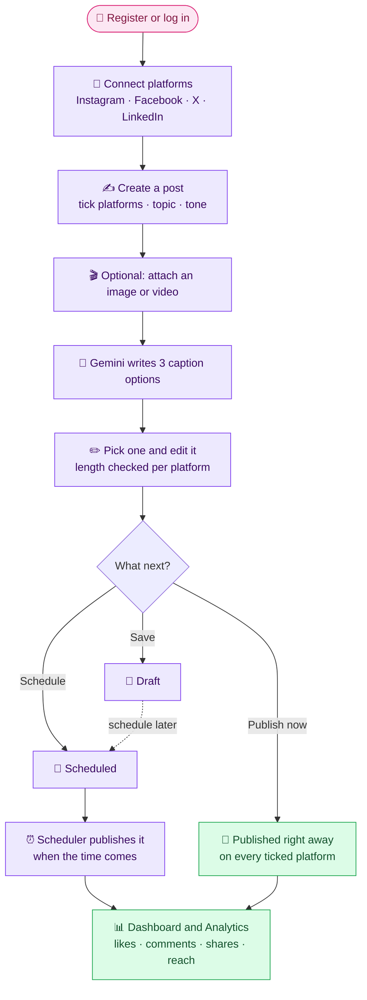

---

## 🧰 Technology stack

| Layer | Technologies | Used for |
|---|---|---|
| 🖥️ **Frontend** |    | Single-page app, dev server and build, page routing |
| 🎨 **UI** |    | Layout and icons, analytics charts, API calls. Also react-calendar, react-hook-form and date-fns |
| ⚙️ **Backend** |     | REST API, the scheduler and cleanup jobs, video uploads |
| 🍃 **Database** |   | Data storage, schemas, validation and indexes |
| 🔐 **Security** |    | Login tokens, password hashing, security headers. Also cors and express-rate-limit |
| 🤖 **AI** |  | Captions through Gemini's OpenAI-compatible endpoint (via the `openai` SDK) |
| 🧪 **Testing** |   | Unit and API integration tests with an in-memory MongoDB (`mongodb-memory-server`) |
| 🚢 **DevOps** |    | Linting, CI on every pull request, frontend hosting (`frontend/vercel.json`) |

---

## 🧩 Architecture

SocialSync has two parts: a **React** single-page app and a **Node/Express** REST API. They talk over
HTTP, and every request after login carries a JWT. The API stores data in **MongoDB**, keeps uploaded
videos on **disk**, asks **Gemini** for captions, and runs the **scheduler** inside the same process.

> [!TIP]
> **How to read these diagrams:** they run top to bottom.
> 🟪 Purple boxes are steps, 🟩 green is success, 🟥 red is rejected or failed, and 🟨 yellow is a
> fallback. On GitHub you can also click a diagram to pan and zoom it.

**Jump to:**
[System overview](#-system-overview) ·
[Request pipeline](#-what-happens-to-every-api-request) ·
[Login](#-login-and-authentication) ·
[AI captions](#-ai-caption-generation) ·
[Video upload](#-uploading-a-video) ·
[Cross-posting](#-posting-to-several-platforms-at-once) ·
[Scheduler](#-the-scheduler) ·
[Video cleanup](#-when-video-files-are-deleted) ·
[Post lifecycle](#-post-lifecycle) ·
[Design decisions](#-design-decisions)

### 🧱 System overview

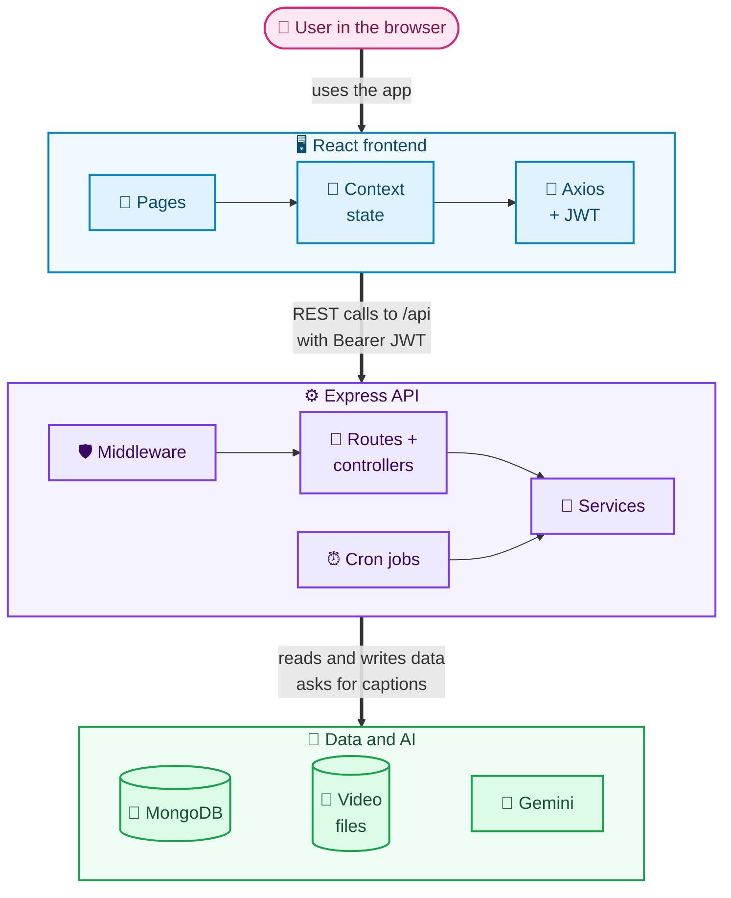

| Part | What it does |
|---|---|
| 📄 **Pages** | Dashboard, Create Post, Schedule, Analytics and Accounts |
| 🧠 **Context state** | Shared React state: Auth, Posts, Accounts and Toast messages |
| 📡 **Axios + JWT** | Sends every API call and adds the login token |
| 🛡️ **Middleware** | helmet, CORS, the 2 MB JSON limit, the JWT check, rate limits and multer for uploads |
| 🧭 **Routes + controllers** | `auth`, `posts`, `media`, `accounts`, `content` and `analytics` |
| 🧩 **Services** | AI captions (Gemini), the publisher, and video storage |
| ⏰ **Cron jobs** | Every minute: publish due posts. Every hour: remove unused uploads |
| 🍃 **MongoDB** | The `users`, `posts` and `socialaccounts` collections |
| 📁 **Video files** | Stored in `uploads/videos/`. The API serves them at `/uploads/...` so the browser can play them |
| 🤖 **Gemini** | Writes the 3 caption options |

### 🚦 What happens to every API request

Every request passes through the same steps in order. Any error ends up in one error handler, which
turns it into a JSON response.

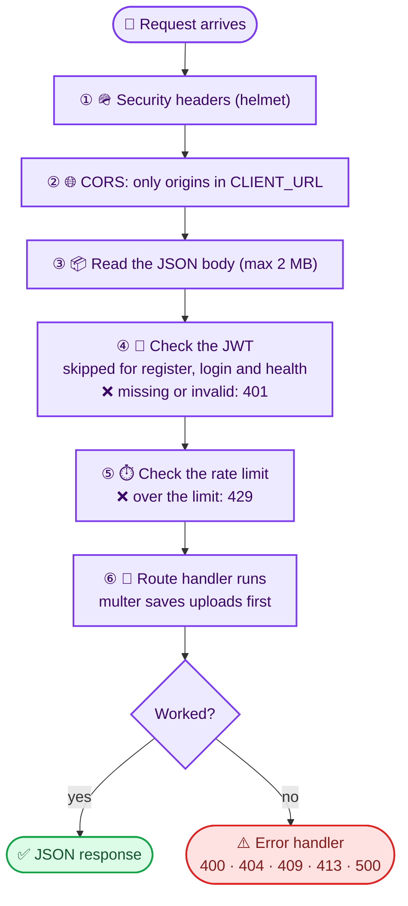

| Rate limit | Applies to | Counted per |
|---|---|---|
| 10 **failed** attempts per 15 minutes | All `/api/auth` routes (register, login, me) | IP address |
| 20 per hour | AI caption generation | User |
| 30 per hour | Video uploads | User |
| None | Every other route | — |

### 🔐 Login and authentication

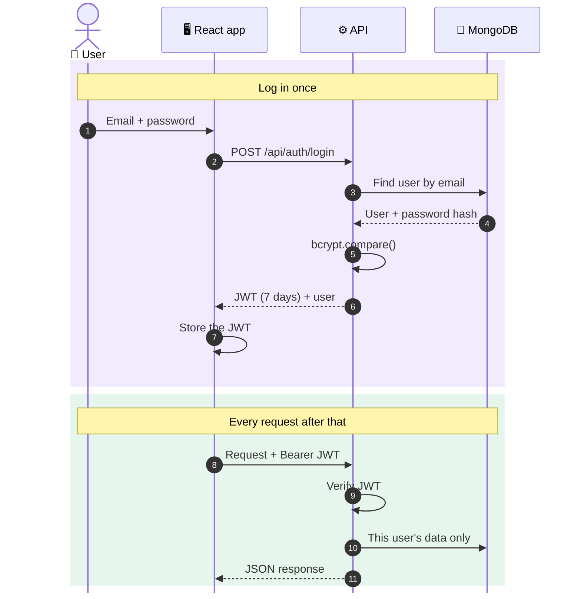

If the token is missing, invalid or expired, the API answers `401`. The app then clears the session and
sends the user to the login page.

### 🤖 AI caption generation

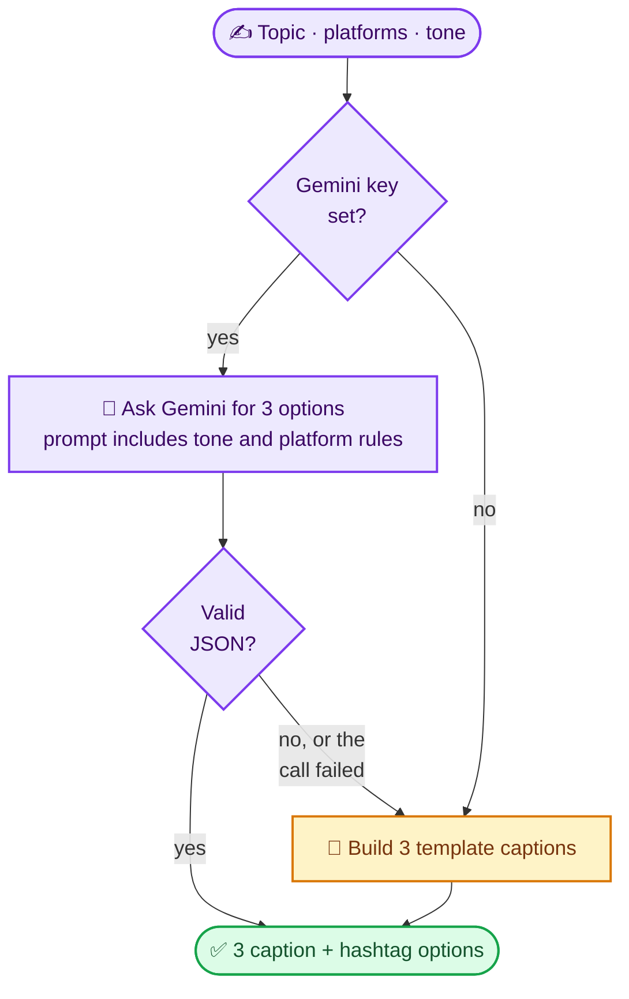

- When several platforms are ticked, the editor sends `platform: 'all'`. Gemini is then asked for one
  caption that fits every network, including X's 280 characters.
- Generation is limited to 20 requests per hour per user, because AI calls cost money.

### 🎬 Uploading a video

Videos upload as soon as they're picked, while the user is still writing. Creating the post later only
sends the small `videoKey`.

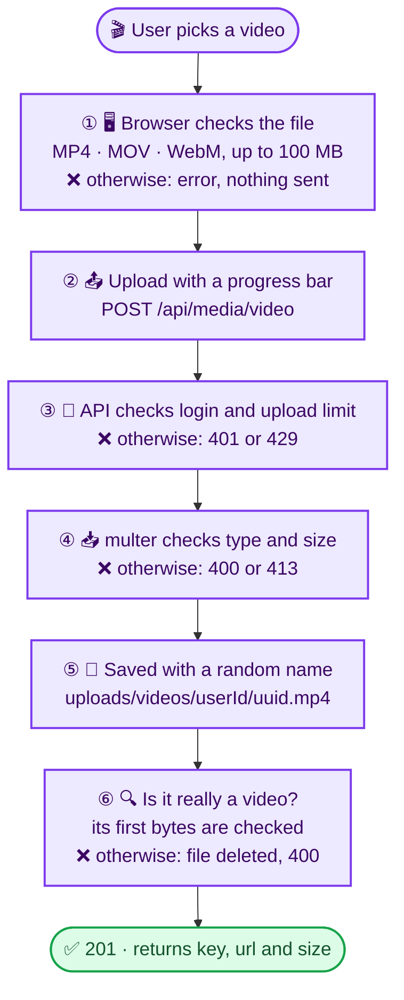

### 📣 Posting to several platforms at once

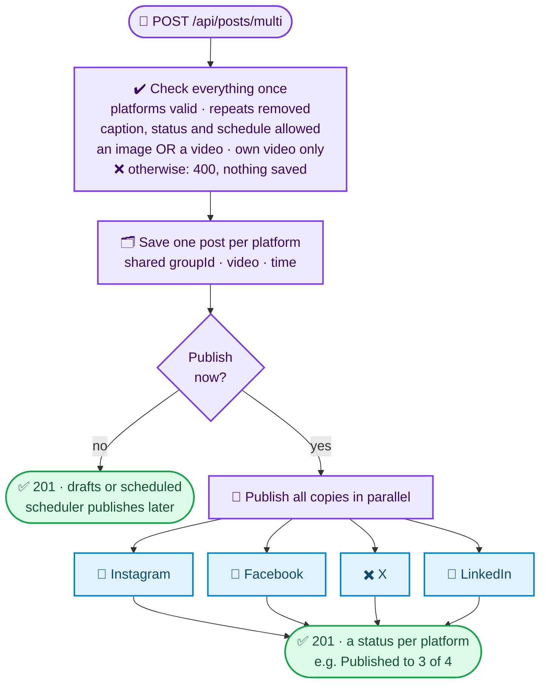

Each platform gets its **own** post, so one platform can fail (for example, no LinkedIn account) while
the others publish. A post can also be edited or deleted on its own.

### ⏰ The scheduler

`node-cron` runs this every minute inside the API process:

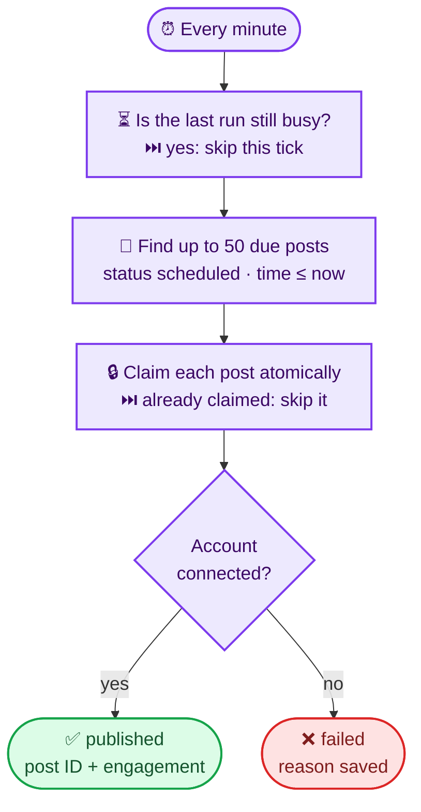

- **🔒 Atomic claim:** each post is claimed with one `findOneAndUpdate({ _id, status: 'scheduled' })`.
  If two ticks overlap, several servers run, or a **Publish Now** click races the scheduler, only one
  of them gets the post. A post is never published twice.
- **♻️ Crash recovery:** when the server starts, any post stuck in `publishing` for more than 10 minutes
  (for example after a crash) is put back to `scheduled`.

### 🧹 When video files are deleted

One video can be shared by every copy of a cross-post, so a file is only deleted when **no post uses it
any more**.

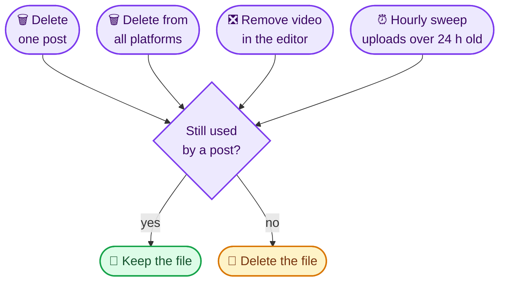

### 📦 Post lifecycle

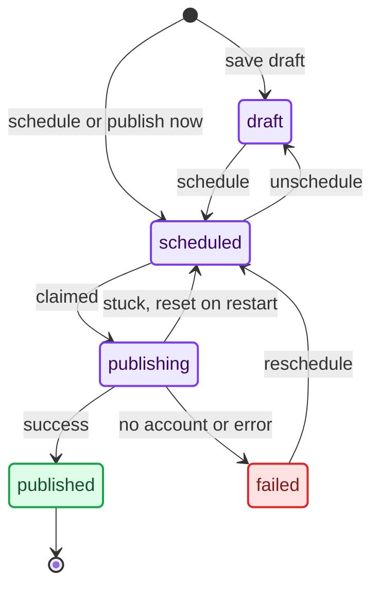

Only the server can move a post to `published` or `failed`. The API rejects any attempt by a client to
set those statuses or to change engagement numbers.

### 💡 Design decisions

| Decision | Why |
|---|---|
| 🔒 Atomic claim in the publisher | A post is never published twice, even with overlapping runs or several servers |
| 🔗 One `Post` per platform, linked by `groupId` | The scheduler, analytics and calendar work unchanged, and each platform can fail or be edited on its own |
| 💾 Videos stored as files, posts store a reference | MongoDB documents max out at 16 MB, so videos can't live inside a post the way images do |
| 🔑 Clients send only a `videoKey` | The server looks up the URL, type and size, so they can't be forged, and refuses other users' videos |
| 🛟 Template fallback for AI | The app keeps working with no API key, a Gemini outage, or a malformed AI response |
| ⏱️ Rate limits per IP for login, per user for AI and uploads | Slows password guessing, and caps the actions that cost money or disk space |
| ⚡ `image` left out of list queries, with a `hasImage` flag | Base64 images are large, so list pages stay fast |
| 🧪 `app.js` separate from `server.js` | Tests load the app without a real database or open port |

📘 For a step-by-step explanation of how video uploads and cross-posting were built, see
[New_Feature.md](New_Feature.md).

---

## 📂 Project structure

```text
Social_Sync_Webapp/
├── backend/                      ⚙️ Node + Express API
│   ├── src/
│   │   ├── server.js             Entry point: loads env, connects to MongoDB, starts the scheduler
│   │   ├── app.js                Express app: middleware, routes, /uploads, error handler
│   │   ├── config/db.js          MongoDB connection
│   │   ├── routes/               URL -> controller mapping (auth, posts, media, accounts, content, analytics)
│   │   ├── controllers/          Request handlers for each route group
│   │   ├── models/               Mongoose schemas: User, Post, SocialAccount
│   │   ├── middleware/           auth.js (JWT check), rateLimit.js, upload.js (multer)
│   │   ├── services/             openaiService (Gemini), publisherService, mediaService (video storage)
│   │   ├── jobs/scheduler.js     Cron jobs: publish due posts, remove unused uploads
│   │   └── utils/                generateToken
│   ├── tests/                    Vitest + Supertest integration tests
│   ├── .env.example              Template for backend/.env
│   └── vitest.config.mjs
│
├── frontend/                     🖥️ React + Vite app
│   ├── src/
│   │   ├── main.jsx, App.jsx     App bootstrap and routes
│   │   ├── components/           accounts, analytics, auth, common, dashboard, editor, schedule
│   │   ├── context/              AuthContext, PostsContext, AccountsContext, ToastContext
│   │   ├── services/             Axios wrappers, one per API resource
│   │   ├── constants/            Platform names, colours, icons and caption limits
│   │   └── utils/                Date and media helpers (with tests)
│   ├── .env.example              Template for frontend/.env
│   └── vercel.json               SPA rewrite so page refreshes work on Vercel
│
├── docs/assets/                  🎨 Logo and banner
├── .github/workflows/ci.yml      🤖 Lint, test and build on pushes to main and on pull requests
├── New_Feature.md                📘 Build guide for video uploads and cross-posting
└── README.md
```

> [!NOTE]
> `backend` and `frontend` are **separate npm packages**. There is no root `package.json`, so install and
> run each one on its own. Uploaded videos go to `backend/uploads/` at runtime. That folder is git-ignored.

---

## ✅ Prerequisites

**Required**

| Tool | Version | Notes |
|---|---|---|
|  | 20.19+ or 22.12+ | Required by Vite 8. npm comes with Node. Check with `node -v` |
|  | Any recent version | A free [MongoDB Atlas](https://www.mongodb.com/atlas) cluster or a local `mongod` |
|  | Any | To clone the repository |

**Optional**

| Tool | Notes |
|---|---|
|  | Get one at [aistudio.google.com](https://aistudio.google.com). Without it, the app uses template captions |

---

## 🚀 Installation and setup

**1️⃣ Clone the repository**

```bash
git clone https://github.com/anurag-joshi-1403/Social_Sync_Webapp.git
cd Social_Sync_Webapp
```

**2️⃣ Install dependencies** for both packages

```bash
cd backend && npm install
cd ../frontend && npm install
cd ..
```

**3️⃣ Create your local environment files** from the templates (`cp` also works in PowerShell)

```bash
cp backend/.env.example backend/.env
cp frontend/.env.example frontend/.env
```

**4️⃣ Fill in `backend/.env`.** At minimum, set `MONGODB_URI` and `JWT_SECRET`. You can generate a strong
secret with Node:

```bash
node -e "console.log(require('crypto').randomBytes(48).toString('base64'))"
```

See [Environment variables](#-environment-variables) for every option.

**5️⃣ Prepare the database.** You only need a reachable MongoDB server and a connection string. There are
no migration or seed scripts. Mongoose creates the collections when data is first saved.

---

## 🔐 Environment variables

> [!CAUTION]
> Never commit `.env` files. Both are already listed in `.gitignore`.

### ⚙️ Backend: `backend/.env`

| Variable | Purpose | Required | Default |
|---|---|:-:|---|
| `MONGODB_URI` | MongoDB connection string (Atlas SRV or `mongodb://`) | ✅ | — |
| `JWT_SECRET` | Secret used to sign login tokens. Use a long random string | ✅ | — |
| `JWT_EXPIRES_IN` | How long a login token lasts | | `7d` |
| `PORT` | API port | | `5000` |
| `NODE_ENV` | `development`, `production` or `test` | | — |
| `CLIENT_URL` | Allowed CORS origins, comma-separated. `*` is a wildcard, as in `https://my-app-*.vercel.app` | | `http://localhost:5173` |
| `GEMINI_API_KEY` | Turns on real AI captions | | — |
| `GEMINI_MODEL` | Gemini model name | | `gemini-2.5-flash-lite` |
| `GEMINI_BASE_URL` | Gemini's OpenAI-compatible endpoint. Change it only if you proxy the API | | Google's endpoint |
| `UPLOAD_DIR` | Folder for uploaded videos | | `backend/uploads` |
| `MAX_VIDEO_MB` | Largest video accepted, in MB | | `100` |
| `FORCE_PUBLIC_DNS` | **Local use only.** Set to `true` if your network can't resolve the Atlas SRV record. See [Troubleshooting](#-troubleshooting) | | unset |

Example (placeholders only):

```dotenv
MONGODB_URI=mongodb+srv://<user>:<password>@<cluster>/<database>
JWT_SECRET=your_long_random_secret
CLIENT_URL=http://localhost:5173
GEMINI_API_KEY=your_gemini_key
```

`.env.example` also lists `FACEBOOK_*`, `TWITTER_*` and `LINKEDIN_*` variables. They are placeholders for
future OAuth work, and the code doesn't read them yet.

### 🖥️ Frontend: `frontend/.env`

| Variable | Purpose | Required | Default |
|---|---|:-:|---|
| `VITE_API_URL` | API base URL, **including** `/api` | | `http://localhost:5000/api` |

If you change `MAX_VIDEO_MB` on the backend, also change `MAX_VIDEO_MB` in
[frontend/src/utils/media.js](frontend/src/utils/media.js), so the editor rejects oversized files before
uploading them.

---

## ▶️ Running the application

Run the backend and the frontend in two terminals.

```bash
# Terminal 1 — ⚙️ API on http://localhost:5000 (restarts on file changes)
cd backend
npm run dev
```

```bash
# Terminal 2 — 🖥️ App on http://localhost:5173
cd frontend
npm run dev
```

The scheduler starts with the API, so posts are only published while the backend is running. Stop
either one with `Ctrl+C`.

### 🎮 First run walkthrough

1. Open `http://localhost:5173` and **register**.
2. Go to **Accounts** and connect one or more platforms. Any username works, because connections are
   simulated.
3. Go to **Create Post**. Tick one or more platforms, type a topic, pick a tone, and optionally attach an
   image or video.
4. Click **Generate Content** and pick one of the options. Edit it if you like.
5. Click **Publish Now**, or schedule it a couple of minutes ahead and wait. Within a minute of the
   scheduled time, the post turns **published**.
6. Open **Schedule**, **Dashboard** and **Analytics** to see the result.

### 📜 Scripts

| Package | Command | What it does |
|---|---|---|
| `backend` | `npm run dev` | Start the API with auto-restart (nodemon) |
| `backend` | `npm start` | Start the API with plain `node` |
| `backend` | `npm test` | Run the tests once (`npm run test:watch` to keep watching) |
| `backend` | `npm run lint` | Lint `src/` and `tests/` |
| `frontend` | `npm run dev` | Start the Vite dev server |
| `frontend` | `npm run build` | Make a production build in `frontend/dist/` |
| `frontend` | `npm run preview` | Serve the production build locally |
| `frontend` | `npm test` | Run the unit tests |
| `frontend` | `npm run lint` | Lint the app |

---

## 📡 API documentation

- 🌐 **Base URL:** `http://localhost:5000/api` locally.
- 🔑 **Authentication:** every route marked 🔒 needs an `Authorization: Bearer <token>` header. You get
  the token from register or login.
- 📦 **Response format:** JSON with a `success` field. Errors look like
  `{ "success": false, "message": "..." }`.
- 🚨 **Common error codes:**
  - `400`: invalid input
  - `401`: missing or invalid token
  - `404`: not found, or owned by another user
  - `409`: duplicate record
  - `413`: upload or request too large
  - `429`: rate limit reached

<details>
<summary><b>🔐 Auth</b></summary>

| Method | Endpoint | Purpose | Auth |
|---|---|---|:-:|
| `POST` | `/auth/register` | Create an account. Body: `{ name, email, password }` (password at least 6 characters) | 🌐 |
| `POST` | `/auth/login` | Get a JWT. Body: `{ email, password }` | 🌐 |
| `GET` | `/auth/me` | The current user | 🔒 |

All `/auth` routes share a limit of 10 failed requests per 15 minutes per IP. Successful requests don't
count.

```json
// POST /api/auth/register → 201
{ "success": true, "message": "Registration successful", "token": "<jwt>",
  "user": { "id": "...", "name": "...", "email": "...", "avatar": "", "role": "user", "createdAt": "..." } }
```

</details>

<details>
<summary><b>📝 Posts</b></summary>

| Method | Endpoint | Purpose | Auth |
|---|---|---|:-:|
| `GET` | `/posts` | The user's posts. Optional `?status=` and `?platform=` filters. Leaves out `image` to stay fast | 🔒 |
| `GET` | `/posts/stats` | Post counts by status | 🔒 |
| `GET` | `/posts/:id` | One post, including its image | 🔒 |
| `POST` | `/posts` | Create a `draft` or `scheduled` post for one `platform`. Optional `image` (base64) or `videoKey` | 🔒 |
| `POST` | `/posts/multi` | Create one post per entry in `platforms`, linked by a `groupId`. Add `publishNow: true` to publish immediately | 🔒 |
| `PUT` | `/posts/:id` | Edit a post. Only user-allowed status changes are accepted | 🔒 |
| `DELETE` | `/posts/:id` | Delete a post. Its video is removed once no other post uses it | 🔒 |
| `DELETE` | `/posts/group/:groupId` | Delete every platform's copy of a cross-post | 🔒 |

```json
// POST /api/posts/multi
{ "platforms": ["instagram", "twitter", "linkedin"], "content": "Launch day!",
  "hashtags": "#launch", "videoKey": "<key from /media/video>", "publishNow": true }

// → 201
{ "success": true, "message": "Published to 2 of 3 platform(s)", "groupId": "...", "count": 3,
  "posts": [ { "platform": "linkedin", "status": "failed",
               "failureReason": "No connected linkedin account", "...": "..." } ] }
```

Use `"status": "draft"`, or `"status": "scheduled"` with a future `"scheduledTime"` (ISO date), instead of
`publishNow`.

</details>

<details>
<summary><b>🎬 Media</b></summary>

| Method | Endpoint | Purpose | Auth |
|---|---|---|:-:|
| `POST` | `/media/video` | Upload one video as `multipart/form-data` in the `video` field. Returns `{ key, url, mimeType, size, originalName }`. Limit: 30 per hour per user | 🔒 |
| `DELETE` | `/media/video/:owner/:file` | Discard your own upload if no post uses it (`:owner/:file` is the `key`) | 🔒 |
| `GET` | `/uploads/videos/:owner/:file` | The stored video. **No `/api` prefix.** Supports Range requests for seeking | 🌐 (unguessable names) |

```bash
curl -H "Authorization: Bearer $TOKEN" -F "video=@clip.mp4;type=video/mp4" \
     http://localhost:5000/api/media/video
```

</details>

<details>
<summary><b>🔗 Accounts · 🤖 Content · 📊 Analytics</b></summary>

| Method | Endpoint | Purpose | Auth |
|---|---|---|:-:|
| `GET` | `/accounts` | Connected accounts, without tokens | 🔒 |
| `POST` | `/accounts/connect` | Connect a platform. Body: `{ platform, username, accessToken }` *(simulated)*. `POST /accounts` does the same | 🔒 |
| `DELETE` | `/accounts/:platform` | Disconnect a platform | 🔒 |
| `POST` | `/content/generate` | 3 AI caption options. Body: `{ topic, platform, tone }`. `platform` can be `all`. Limit: 20 per hour per user | 🔒 |
| `GET` | `/analytics?range=7\|14\|30` | Engagement from published posts (default 30 days) | 🔒 |

Valid platforms are `instagram`, `facebook`, `twitter` and `linkedin`.

</details>

<details>
<summary><b>💓 Health</b></summary>

| Method | Endpoint | Purpose | Auth |
|---|---|---|:-:|
| `GET` | `/` | Liveness check (no `/api` prefix) | 🌐 |
| `GET` | `/api/health` | Uptime and environment | 🌐 |

</details>

🔒 = needs a JWT · 🌐 = public. There is no Swagger/OpenAPI specification. The route files in
[backend/src/routes](backend/src/routes) are the source of truth.

---

## 🗄️ Database design

SocialSync uses **MongoDB** through **Mongoose**. It has three collections, and every post and account
belongs to one user.

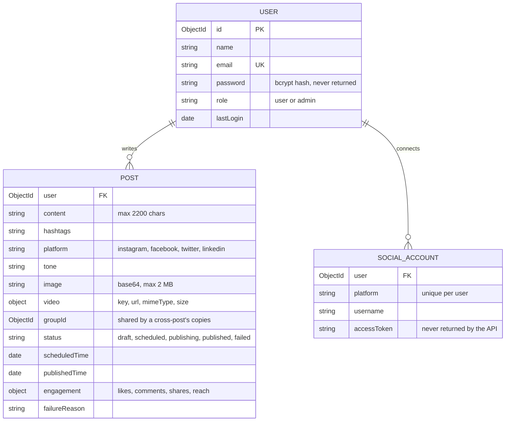

- 📇 **Indexes:**
  - `{ status, scheduledTime }` keeps the scheduler's lookup fast.
  - `{ user, platform }` is unique on social accounts, so each user has one account per platform.
  - `email` is unique on users.
- 🌱 **No migrations or seed data.** Collections are created on the first write, and Mongoose builds the
  indexes defined in the models.
- 🍃 **Why MongoDB:** posts are naturally document-shaped. Nested engagement numbers, an optional image
  or video, and flexible metadata fit a document better than several joined tables.

---

## 🧪 Testing

Both packages use **Vitest**.

```bash
cd backend && npm test      # API integration tests
cd frontend && npm test     # unit tests
```

- ⚙️ **Backend tests** use Supertest against the Express app and start an **in-memory MongoDB**, so you
  don't need a database or `.env`. They cover:
  - auth
  - posts and ownership rules
  - the scheduler (including double-publish races)
  - analytics
  - rate limits
  - video uploads (type, size and content checks)
  - cross-posting and Publish Now

  The first run downloads a MongoDB binary, which can take a few minutes.
- 🖥️ **Frontend tests** cover the date helpers and the media helpers. There are no component or
  end-to-end tests yet.

### 🤖 Continuous integration

[.github/workflows/ci.yml](.github/workflows/ci.yml) runs on every push to `main` and on every pull
request:

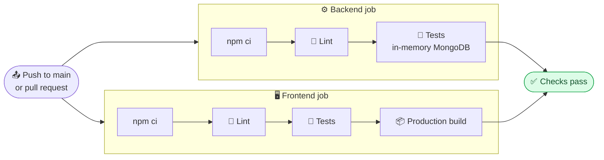

The frontend build step catches import-path case mistakes that Windows allows but Linux doesn't.

---

## 🌍 Build and deployment

**📦 Frontend build:**

```bash
cd frontend
npm run build      # output in frontend/dist/
npm run preview    # serve the build locally to check it
```

| Part | Where | What to set |
|---|---|---|
| 🖥️ **Frontend** |  (`frontend/vercel.json` sends every route to `index.html`) | `VITE_API_URL` = your API URL, ending in `/api` |
| ⚙️ **Backend** | Any Node.js host. The repository contains no backend hosting config | Run `npm start` in `backend/`. Set `NODE_ENV=production`, `MONGODB_URI`, `JWT_SECRET` and `CLIENT_URL` (add `https://<your-app>-*.vercel.app` for preview deploys). Don't set `FORCE_PUBLIC_DNS` |

> [!WARNING]
> **Video storage needs a persistent disk.** Videos are written to `UPLOAD_DIR` on the server's disk.
> Hosts with an ephemeral filesystem lose them on every redeploy or restart. Mount a persistent disk
> and point `UPLOAD_DIR` at it, or move storage to S3 or Cloudinary, as described in
> [New_Feature.md](New_Feature.md#step-17-production-move-videos-to-object-storage).

- 📏 **Raise upload limits on proxies.** If a reverse proxy sits in front of the API, raise its request
  size limit, or large uploads fail before they reach Express.
- 📈 **The API is stateless**, apart from video files on disk. Logins use JWTs with no server sessions,
  and the atomic claim makes it safe to run the scheduler on several instances.

---

## 🩺 Troubleshooting

| Problem | Fix |
|---|---|
| 🟢 `npm run dev` in `frontend` fails or warns about the Node.js version | Vite 8 needs Node 20.19+ or 22.12+. Upgrade Node |
| 🍃 `querySrv ECONNREFUSED` when connecting to Atlas | Some networks fail the Atlas SRV DNS lookup. Set `FORCE_PUBLIC_DNS=true` in `backend/.env` to use Google's DNS. **Local only:** on a server it overrides DNS for the whole process |
| 🔑 Register or login returns a 500 error mentioning `JWT_SECRET` | `JWT_SECRET` is missing. Set it in `backend/.env` and restart the API |
| 🔌 Port `5000` is already in use | Stop the other program, or set `PORT` in `backend/.env` and update `VITE_API_URL` to match. On macOS, the AirPlay Receiver often uses port 5000 |
| 🌐 CORS error in the browser | Add your frontend's origin to `CLIENT_URL` (comma-separated) and restart the API |
| 🤖 Captions look generic or templated | `GEMINI_API_KEY` is missing or invalid, so the template fallback is used. Look for `No GEMINI_API_KEY set` or `Gemini error` in the backend console |
| 🖼️ `413` when saving a post with an image | Images are limited to 2 MB. Use a smaller image |
| 🎬 `413 Video is too large` | The video is over `MAX_VIDEO_MB` (default 100) |
| 🔍 *"That file doesn't look like a valid … video"* | The file's content doesn't match its type, for example a renamed file. Re-export it as MP4 |
| ▶️ An uploaded video doesn't play | Check that `VITE_API_URL` points to the API that stored the file |
| ⏰ A scheduled post never publishes | Make sure the backend is running and an account is connected for that platform. Without one, the post is marked `failed` with a reason |
| 💾 Videos disappear after a redeploy | The host's disk is ephemeral. See [Build and deployment](#-build-and-deployment) |

---

## 🛡️ Security notes

**✅ Built in:**

- 🔐 Passwords are hashed with bcrypt and never returned (`select: false`). Social account tokens are
  removed from every API response.
- 👤 Every query is scoped to the logged-in user. Another user's posts and groups return `404`, and
  another user's video key can't be attached or deleted.
- 🧾 The server owns post statuses and engagement numbers. Clients can't mark a post as published.
- 🪖 `helmet` sets security headers. CORS only allows the origins in `CLIENT_URL`. JSON bodies are capped
  at 2 MB. In production, unexpected errors return a generic message.
- ⏱️ Rate limits apply to failed logins (per IP), AI generation and video uploads (per user).
- 🎬 Video uploads are checked three ways:
  - allowed types only
  - a size limit
  - a check of the file's first bytes, so a mislabelled file is rejected.

  Files get random names in per-user folders, and keys are validated, which blocks path traversal.

**📋 Your responsibilities:**

- 🗝️ Keep secrets in `backend/.env`, never in code or commits. Use a long random `JWT_SECRET`. If a secret
  is ever committed, **rotate it**: removing the file from git doesn't remove it from history.
- 🏭 Set `NODE_ENV=production` and a precise `CLIENT_URL` in production.

**⚠️ Known weaknesses** (see the [Roadmap](#-roadmap)):

- JWTs are kept in `localStorage`, which any script on the page can read.
- Social account tokens are stored in plain text. That's harmless while connections are mocked, but
  they must be encrypted before real OAuth is added.
- Uploaded videos are publicly readable to anyone who has the exact URL.

---

## 🚧 Known limitations

- 🔌 Publishing, OAuth and engagement numbers are **simulated**.
- 🖼️ Images are stored as base64 inside the post document, with a 2 MB limit.
- 💾 Videos are stored on the API server's local disk (see [Build and deployment](#-build-and-deployment)).
- 📏 Caption length limits for each platform are warnings in the editor. The API doesn't enforce them.
- 📄 `GET /posts` has no pagination.
- 🧪 Frontend tests only cover helper functions.

---

## 🎯 Roadmap

**✅ Done:**

- [x] 🎬 Video uploads
- [x] 📣 Multi-platform posts: one submit creates a post for each selected platform

**🛠️ Not built yet:**

- [ ] 🔗 Real OAuth and one publishing adapter per platform
- [ ] 🔐 Encrypt tokens at rest, and move JWTs to httpOnly cookies with refresh tokens
- [ ] ☁️ Object storage for images and videos (S3 or Cloudinary)
- [ ] 📈 An engagement sync job that pulls real metrics
- [ ] ✏️ Per-platform caption overrides inside a cross-post
- [ ] 🔁 Automatic retries with backoff for failed posts
- [ ] 📄 Pagination on `GET /posts`
- [ ] 👥 Teams and workspaces with an approval flow
- [ ] 🧪 Frontend component tests and end-to-end tests

---

## 🤝 Contributing

There is no formal contribution guide yet. To propose a change:

1. 🍴 Fork the repository and create a branch from `main`.
2. 🛠️ Make your change, and add or update tests where it makes sense.
3. ✅ Run the same checks as CI:

   ```bash
   cd backend && npm run lint && npm test
   cd ../frontend && npm run lint && npm test && npm run build
   ```

4. 📬 Open a pull request that describes what changed and why.

---

## 📄 License

No license file was found in this repository. (`backend/package.json` lists `"ISC"`, which is npm's
default value, not a license grant.) Until the owner adds a `LICENSE` file, all rights are reserved by
default. If you plan to reuse the code, ask the author first.

---

## 👤 Author

<div align="center">


Made with ❤️ by **[Anurag Joshi](https://github.com/anurag-joshi-1403)**

⭐ If you find this project useful, consider giving it a star!

</div>
